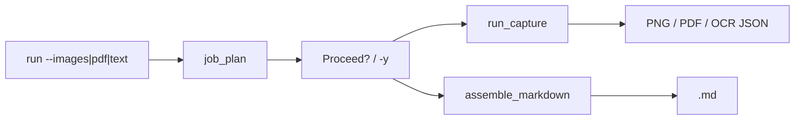

# ebook_capture

화면의 고정 영역(또는 지정 창)을 연속 캡처해 PNG를 모으고, 선택에 따라 **이미지 PDF** 또는 **Google Gemini OCR + Markdown**까지 만드는 도구입니다. CLI와 PyQt5 GUI를 제공합니다.

| 문서 | 대상 |
|------|------|
| [docs/USAGE.md](docs/USAGE.md) | **사용자** — 설치 후 사용법, 옵션, 리더 프로필 |
| [docs/REQUIREMENTS.md](docs/REQUIREMENTS.md) | **개발자** — 요구사항, 아키텍처, 파이프라인, 문제/해결책 |
| [docs/CONTEXT.md](docs/CONTEXT.md) | **다음 세션** — Kindle 검증 상태, 다른 리더 튜닝 TODO |
| [reader/docs/](reader/docs/) | **웹 리더** — 기능 기획, 주석·AI 문답 추가 기획 |

## 출력 3종

| output | 생성물 | 설명 |
|--------|--------|------|
| **images** | `tmp/{title}_NNNN.png` | 페이지 캡처만 |
| **pdf** | PNG + `{title}.pdf` | 이미지 PDF (기본) |
| **text** | `*.ocr.json` + `{title}.md` | OCR → JSON → Markdown 조립 |

`config`의 `output_mode`와 CLI의 `--images` / `--pdf` / `--text`는 동일한 값입니다.

## 프로젝트 구성

저장소 루트가 곧 Python 패키지(`python -m ebook_capture`)라서 코드와 기본 설정 파일은 루트에 둡니다.

```text
__init__.py, __main__.py       # 패키지 진입점 (python -m ebook_capture)
ebook_capture.py               # 설치형 진입점 (ebook-capture 명령)
cli.py                         # gui | run | test-key | inspect
core/                          # 캡처 · OCR · PDF · assemble (Qt 없음)
gui/                           # PyQt → run -y 서브프로세스
assets/                        # OCR 프롬프트, 언어 CSV, Qt UI
tests/                         # pytest (fixtures/ 에 샘플 OCR JSON)

default_config.json(c)         # 책 정보 (title/pages/output; reader_profile 이름)
reader_profiles.jsonc          # 전자책 뷰어별 동작 (키·클릭·delay·pdf_trim)
ocr_typos.txt                  # OCR 오타 사전 (프로젝트 공통)
.env.example                   # API 키 예시

reader/                        # 웹 리더 '여백' — 만든 Markdown을 읽는 브라우저 앱 (빌드·서버 없음)
  index.html, app.js, notes.js, styles.css
  PRODUCT.md, DESIGN.md        # 제품·디자인 요약
  docs/                        # 기능기획.md, 추가기획.md

docs/                          # USAGE · REQUIREMENTS · CONTEXT
  history/                     # 끝난 계획, 일회성 작업 기록

pyproject.toml, uv.lock, requirements.txt
activate.cmd, run_tests.cmd    # Windows: venv 활성화, 테스트 실행
```



## 설치

```bash
cd /path/to/ebook_capture
pip install -e .
# 개발·테스트:
pip install -e ".[dev]"
```

Python **3.10+** 권장. Windows 캡처·창 제어가 주 대상입니다.

## 빠른 시작

### GUI

```bash
python -m ebook_capture gui
```

1. **Reader**에서 Kindle / Aladin 등 선택  
2. **Folder / Title / Pages**, 대상 창 선택  
3. **Output** → **Start**

### CLI

```bash
python -m ebook_capture run --config default_config.jsonc --reader kindle_app --pdf -y
python -m ebook_capture run --title "My Book" --base-dir E:/ebook --text -y
```

중간 산출물이 없으면 실행 단계를 보여 주고 확인합니다. `-y`로 생략합니다.

## 웹 리더

`reader/index.html`을 브라우저로 열고 "폴더 열기"로 책 폴더(`{title}.md`와 `assets/`가 있는 곳)를 고릅니다. 목차 트리, 검색, 하이라이트·메모, 주석 파일 저장, Claude에게 묻기(API 키는 설정에서 입력)를 지원합니다. 자세한 내용은 [reader/docs/추가기획.md](reader/docs/추가기획.md).

## 저장 경로

```text
{base_dir}/{title}/
  tmp/{title}_0001.png
  tmp/{title}_0001.ocr.json
  {title}.pdf
  {title}.md
  {title}.notes.json            # 웹 리더의 주석 (리더가 씀)
  capture_state.json
```

## 환경 변수 (OCR)

- `GOOGLE_API_KEY` — Gemini OCR (`--text`)에 필요  
- `GOOGLE_API_TRUST_MODE` — `auto` | `system`(사내망) | `certifi`  
- 예시: [`.env.example`](.env.example)

## 라이선스

개별 파일에 다른 라이선스가 붙어 있을 수 있습니다. 새 패키지 코드는 프로젝트 정책에 맞게 정리하세요.
