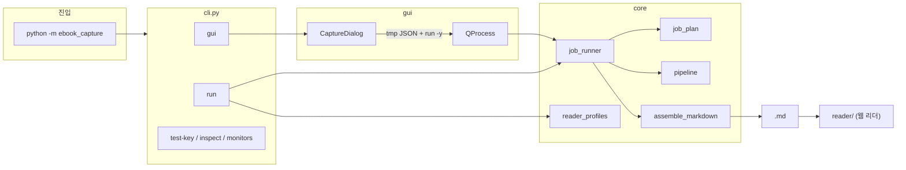

# ebook_capture — 구조와 동작 규칙 (개발자용)

사용법은 [USAGE.md](USAGE.md), 지금 상태와 할 일은 [CONTEXT.md](CONTEXT.md), 날짜별 기록은 [HISTORY.md](HISTORY.md)에 있다. 이 문서는 요구사항, 아키텍처, 모듈 책임, 파이프라인 단계별 규칙, 발견한 문제와 해결책을 다룬다.

---

## 1. 목적 · 범위

Windows에서 전자책 리더(앱/웹/원격 데스크톱) 화면을 연속 캡처해 **PNG**, **이미지 PDF**, 또는 **OCR → Markdown**을 만든다. 만든 Markdown은 같은 저장소의 웹 리더(`reader/`, [reader/SPEC.md](../reader/SPEC.md))로 읽는다.

- 지원 환경: Windows, RDP/DPI/다중 모니터, 사내망 SSL(프록시 CA)
- OCR 엔진: Google Gemini, Anthropic Claude Vision, Datalab(호스팅 Marker)
- 비범위: DRM 우회, 비-Windows 1급 지원, GUI 내부의 장시간 캡처 루프, 표 추출 같은 문서 후가공

---

## 2. 기능 요구사항

### 2.1 캡처

- 영역: `manual` | `window_full` | `window_left_third` | `window_right_third` | `screen_left_third`, 창 안 부분 영역(`window_subrect`)
- 시작 시 창 resize/포커스는 옵션 (`fit_on_start`, `start_focus_clicks`, `capture_scale`; 기본 끔)
- 페이지 넘김: `next_key`(키 이름 또는 `wheeldown`/`wheelup`) + `key_delivery` (SendInput / PostMessage / PyAutoGUI / auto)
- 포커스: 시작 1회(`start_focus_clicks`)와 **캡처 직전** 매 페이지(`reader_focus_clicks`) 분리. 클릭 위치 `reader_focus_x_ratio`/`_y_ratio`, 클릭 후 포인터를 캡처 밖으로 빼고 `focus_click_settle_sec` 대기
- 안정화: 연속 두 장이 같아질 때까지 재촬영(`settle_stable_sec`/`settle_max_sec`), 화면이 안 바뀌면 재포그라운드 + 키 재전송(`page_turn_retries`)
- 책 끝 감지: 회색 썸네일 평균 차이 ≤ `stop_repeat_tolerance`(기본 0.3)가 반복되면 끝
- 캡처 중 화면 보호기 차단(`prevent_sleep`), 커서 숨김(`hide_cursor_during_capture`)
- 백엔드: `printwindow` (HWND) | `screen` (mss)

### 2.2 잡 계획 · 재개

- `plan_job()`이 기존 산출물을 보고 필요한 단계만 제안; `-y`가 없으면 확인
- PNG는 **설정된 페이지 범위 전부**가 있는지 본다(`png_complete`). 일부만 있으면 캡처를 이어서 한다
- 소스 우선순위(`text`): 명시한 `--input-pdf` → `tmp/*.png` → 책 폴더 PDF → 화면 캡처. 명시한 PDF인데 `n_pages`가 기본값 1이면 PDF 전체 쪽 수로 올린다
- 페이지 단위 resume: `capture_state.json` + 파일 검증, `.part` → `os.replace`
- `--force-phase capture|ocr|pdf|all`, `--no-resume`(남아 있던 `end_of_book_last_page`도 버림)

### 2.3 OCR / Markdown / PDF

- OCR: `google_ocr.py`(Gemini, SSL 공통), `anthropic_ocr.py`(Claude Vision), `datalab_ocr.py`(Marker). 셋 다 `tmp/{title}_NNNN.ocr.json`의 같은 section 형식으로 쓴다
- OCR 단계는 엔진 공통: 건너뛸 쪽을 먼저 거르고, `ocr_workers>1`이면 동시 요청, 한 쪽 실패는 `OCR_PAGE_FAIL`로 남기고 계속
- Markdown: `assemble_style` = `full` | `prose` | `raw`, 조립 규칙은 §8
- PDF: PNG → 페이지 PDF → merge. `pdf_trim`(비율 crop + white fill), `pdf_auto_crop`(공통 윤곽 자동 추출), `pdf_page_margin`(흰 여백)

### 2.4 리더 프로필

- `reader_profiles.jsonc` + `core/reader_profiles.py`. CLI `--reader` / GUI Reader 콤보 / config `reader_profile`
- 우선순위: **개별 CLI 플래그 > `reader_profiles.jsonc` > built-in > `CaptureConfig` 기본값**
- 공통 루프 값은 `_proven_capture_defaults()`(`kindle_app` 검증분). 리더마다 다른 것은 `next_key` / `key_delivery` / `target_window_title` / `pdf_trim` / 포커스 클릭 / note
- 프로필별 값과 검증 상태는 USAGE §4, CONTEXT §2

### 2.5 CLI / GUI

| 명령 | 역할 |
|------|------|
| `run` | 메인 잡 (`--images` / `--pdf` / `--text`) |
| `gui` | 옵션 UI → 임시 JSON → `run -y` 서브프로세스 |
| `monitors` | 모니터 번호·해상도 (`--capture-monitor`용) |
| `test-key` | 페이지 넘김 키 스모크 |
| `inspect` | 창/캡처 rect 진단 |

GUI는 캡처 루프를 돌리지 않는다. core는 Qt에 의존하지 않는다.

---

## 3. 아키텍처



### 레이어

| 레이어 | 책임 |
|--------|------|
| **core** | 설정, 캡처, OCR, PDF, 조립, 프로필. headless |
| **cli** | argparse, 설정 병합, 진단 명령 |
| **gui** | 옵션 수집·로그 표시; 실행은 subprocess |
| **reader** | 만든 Markdown을 읽는 브라우저 앱. Python 코드와 독립 |

### 소스 맵

```text
__init__.py, __main__.py     python -m ebook_capture 진입
ebook_capture.py, cli.py     설치형 진입, argparse
core/
  config.py                  CaptureConfig, PdfTrim, JSONC 로드
  reader_profiles.py         리더별 동작 오버레이, _proven_capture_defaults
  job_plan.py                산출물 → 단계 계획
  job_runner.py              plan → confirm → pipeline / assemble
  pipeline.py                Phase I/II/III (capture / OCR / PDF), 페이지 루프
  windows_util.py            HWND, fit, key/wheel delivery, focus clicks, keep_display_awake
  win32_bitmap_capture.py    PrintWindow
  screen_capture.py          mss / pyautogui region, DPI
  google_ocr.py              Gemini OCR + SSL trust + JSON 복구
  anthropic_ocr.py           Claude Vision OCR
  datalab_ocr.py             Datalab(Marker) OCR, 블록 → section 분류, 그림 저장
  pdf_input.py               입력 PDF 쪽 수·한 쪽 잘라내기
  image_pdf.py               PNG → PDF (+ trim, fill, margin)
  auto_crop.py               캡처 공통 윤곽·리더 크롬 감지
  ocr_json_loader.py         tmp/*.ocr.json 로드 (PageRecord, SectionBlock)
  ocr_typo_fix.py            사전 기반 OCR 오타 교정
  llm_proofread.py           Claude OCR 오인 교정 (--proofread)
  text_reflow.py             쪽 안 줄바꿈 정리
  seam_repair.py             쪽 경계 띄어쓰기 판단, 두 줄 제목 병합
  paragraph_merge.py         쪽 안·쪽 경계 문단 병합, 코드 블록 병합
  section_normalize.py       절 번호·제목 등급 정리
  book_structure.py          장 경계 감지, 목차
  markdown_render.py         구조 → Markdown
  assemble_markdown.py       조립 단계 순서
  assemble_options.py        full / prose / raw 프리셋
gui/
  app.py                     Dialog ↔ CaptureConfig ↔ QProcess
  ui_capture.py, theme.py, snipping.py
assets/                      OCR 프롬프트, 언어 CSV, Qt UI
reader/                      웹 리더 (reader/README.md)
tests/                       pytest, fixtures/sample_book
```

---

## 4. 설정 모델 (`CaptureConfig`)

GUI와 CLI가 같은 스키마를 쓴다. 파일은 둘로 나눈다.

| 파일 | 담는 것 |
|------|---------|
| `default_config.jsonc` (책) | `title`, `base_dir`, `n_pages`, `start_page`, `output_mode`, `reader_profile`(이름), `resume`, `force_phase`, OCR/조립 |
| `reader_profiles.jsonc` (리더) | `capture_mode`, `target_window_title`, `next_key`, `key_delivery`, `delay_sec`, focus/fit, settle, `pdf_trim`, `pdf_auto_crop`, backend… |

런타임 `CaptureConfig`는 둘을 merge한 결과다. 주요 필드 그룹:

| 그룹 | 필드 | 주로 있는 파일 |
|------|------|----------------|
| 책/출력 | `title`, `base_dir`, `n_pages`, `start_page`, `output_mode`, `assemble_style` | 책 |
| 잡 | `resume`, `force_phase`, `skip_capture`, `input_pdf`, `reader_profile` | 책 |
| OCR | `ocr_engine`, `ocr_workers`, `ocr_lang`, `ocr_text_prompt`, `ocr_prompt_file`, `datalab_mode`, `anthropic_ocr_model` | 책 |
| 캡처 | `capture_mode`, `target_window_title`, `rect`, `window_subrect`, `window_capture_backend`, `use_window_client_rect`, `hide_cursor_during_capture`, `delay_sec`, `capture_scale`, `capture_monitor` | 리더 |
| 키 | `next_key`, `key_delivery`, `page_turn_retries` | 리더 |
| 캡처 전 포커스 | `reader_focus_clicks`, `reader_focus_x_ratio`, `reader_focus_y_ratio`, `focus_click_settle_sec`, `keep_pointer_outside` | 리더 |
| 안정화·끝 | `settle_stable_sec`, `settle_max_sec`, `stop_repeat_tolerance`, `prevent_sleep` | 리더/기본값 |
| 시작 | `fit_on_start`, `start_focus_clicks`, `start_focus_x_ratio`, `start_focus_y_ratio` | 리더 |
| PDF | `pdf_trim`(left/right/top/bottom crop, fill_* 흰 덮개, 비율 0–0.45), `pdf_auto_crop`, `pdf_auto_crop_margin`, `pdf_page_margin` | 리더 |

Phase 파생:

- `run_capture_phase` — skip/PDF 입력이 아닐 때
- `run_ocr_phase` — `output_mode == text`
- `run_pdf_phase` — `output_mode == pdf` (`skip_capture`와 무관 — 기존 PNG만으로 PDF 가능)

산출물 경로는 USAGE §7.

---

## 5. 실행 흐름

### 5.1 `run`

1. config 로드 (`--config` 또는 title + base-dir)
2. `--reader` / `reader_profile` 적용
3. CLI 플래그로 덮어쓰기
4. `plan_job` → `confirm_steps` (`-y`면 생략)
5. 필요하면 `run_capture` → 필요하면 `assemble_markdown`

### 5.2 Job plan

| output | 단계 |
|--------|------|
| images | CAPTURE |
| pdf | CAPTURE → BUILD_PDF |
| text | CAPTURE/OCR(PNG\|PDF) → ASSEMBLE |

### 5.3 페이지 루프 (`pipeline._run_phase_capture`)

시작(`_pin_capture_target`): 대상 창 pin → `fit_on_start`이면 resize → `start_focus_clicks` → `pinned_capture_rect` 고정. 첫 캡처 직전에 `delay_sec` 대기(`CAPTURE_SETTLE`).

페이지마다:

1. `READER_FOCUS` — 본문 비율 좌표에 `reader_focus_clicks`회 클릭(간격 > `GetDoubleClickTime`)
2. 포인터를 캡처 **옆**으로 대피 → `focus_click_settle_sec` 대기(오버레이 소멸)
3. 스크린샷(필요하면 연속 두 장이 같아질 때까지 재촬영)
4. `TARGET_KEY_SENT` — `next_key`
5. `delay_sec` 후 다음 페이지. 화면이 안 바뀌면 재포그라운드 + 재전송(`PAGE_TURN_RETRY`), 그래도 같으면 책 끝

`debug_capture`면 `DEBUG_KEY_EFFECT meandiff=… (page moved | NO VISIBLE CHANGE)`로 키 효과를 찍는다. 회귀 테스트: `tests/test_capture_order.py`.

---

## 6. 설계 원칙

1. **GUI와 장시간 작업 분리** — GUI freeze / Qt↔Win32 혼합 방지
2. **민감정보는 `.env`만** — 키·인증서 경로 하드코딩 금지
3. **외부 API는 엔진별 한 모듈** — Client/SSL을 한곳에 모음
4. **원자적 쓰기** — `.part` 후 `os.replace`, 출력은 LF
5. **manifest + 파일 검증** — resume 시 상태만 믿지 않음
6. **캡처 / OCR / PDF / 조립 분리** — OCR 실패가 PNG를 망가뜨리지 않고, 조립 규칙만 바뀌면 재OCR 없이 다시 조립
7. **리더 차이는 프로필로** — 코드 분기 대신 `reader_profiles.jsonc`
8. **OCR 교정은 파이프라인에서** — 리더(`reader/`)는 읽기만 한다. 리더에 있는 쪽 경계 복원은 이미 만든 Markdown을 위한 보조 장치

---

## 7. 캡처 구현 메모 (Windows / RDP)

| API | 의미 |
|-----|------|
| `GetWindowRect` | 외곽 frame (타이틀바 포함) |
| `GetClientRect` + `ClientToScreen` | client 원점/크기 |
| `GetWindowInfo.rcClient` | 화면 좌표 client (DPI 주의) |

- **printwindow**: RDP/창 캡처에 유리 (HWND 비트맵)
- **screen**: mss 영역 캡처; DPI·멀티모니터 좌표에 민감. `screen_left_third`, `rdp_full`에 사용
- `inspect`와 `run`은 같은 시점에 `ensure_windows_capture_environment()`를 불러 DPI 모드를 맞춘다. probe 좌표를 `--sub-*`에 그대로 써도 된다
- 검은 이미지 디버그 순서: HWND/제목 → backend → rect → DPI. 원인을 trim으로 가리지 말 것

로그 토큰: `DEBUG_RECT`, `READER_FIT`, `START_FOCUS`, `CAPTURE_SETTLE`, `READER_FOCUS`, `POINTER_HIDE`/`POINTER_RESTORE`, `TARGET_KEY_SENT`, `TARGET_KEY_RETRY`, `PAGE_TURN_RETRY*`, `SETTLE_STABLE`/`SETTLE_TIMEOUT`, `SLEEP_BLOCK`, `DEBUG_KEY_EFFECT`, `IMAGE_OK`, `CAPTURE_SKIP`, `CAPTURE_END_OF_BOOK_RESET`, `OCR_*`, `PDF_*`, `PDF_AUTO_CROP`, `ASSEMBLE_*`, `PROOFREAD_*`.

### PDF 자르기

- `pdf_trim`은 캡처 폭/높이의 비율. `left/right/top/bottom`은 잘라내고, `fill_*`는 잘라내지 않고 그 띠를 흰색으로 덮는다
- `pdf_auto_crop`: 각 PNG의 바깥 테두리를 벗겨 가며 "채워진 상자"를 찾고, 페이지마다 가장 바깥 상자의 중앙값을 공통 윤곽으로 쓴다. 상자가 없으면 내용 상자의 합집합. 2단계로 상하단에서 30% 이상 페이지에 똑같이 반복되고 비균일 행(아이콘)이 있는 띠를 리더 크롬으로 보고 자른다. 로그 `PDF_AUTO_CROP source=… chrome=(top …, bottom …)`

---

## 8. Markdown 조립 규칙

`assemble_markdown()` 순서: OCR JSON 로드 → 사전 오타 교정 → (선택) LLM 교정 → 문단 정리(`full`/`prose`) → 장 구조 → 렌더. 조립 규칙만 바뀌었을 때는 재OCR 없이 다시 조립한다. Datalab은 `core.datalab_ocr.rebuild_page_structure()`로 `blocks_raw`에서 섹션도 다시 만든다(과금 0).

### 8.1 OCR 블록 → section (Datalab)

Datalab의 유형 블록(SectionHeader / Text / Caption / Footnote / Table / Equation / PageHeader …)을 section 타입(`title` / `section_title` / `body` / `caption` / `footnote` / `table` / `equation` / `header` / `page_number`)으로 대응시킨다. 프롬프트가 없으므로 `--ocr-prompt*`, `--ocr-lang`은 무시된다.

- 제목 등급은 Marker의 h1/h2가 아니라 **블록 위치**로 정한다(리플로우 리더는 번호 목록·인용·미주를 큰 글자로 그린다). 가운데 정렬 → `section_title`(###), 왼쪽 정렬 → `subtitle`(####), 본문 폭 80% 이상이나 `1. …` 번호 항목 → `body`, 그림 바로 아래 → `caption`, 장 라벨(`Chapter N`, `PART N`, `N장`) → `title`, 숫자만/장식 기호만 → 버림. 페이지 중심·폭은 그 페이지 bbox의 min/max로 추정한다(Datalab bbox 좌표계는 보낸 이미지보다 약 1.2배 크다)
- Picture/Figure 블록의 설명문(모델이 지어낸 글)은 버린다. `blocks_raw`(유형 + HTML + bbox)를 `.ocr.json`에 같이 저장한다

### 8.2 블록별 변환

| 원본 | Markdown |
| --- | --- |
| 수식(별행) | `$$`를 앞뒤 별도 줄에 둔 블록(Typora는 한 줄짜리 `$$…$$`를 렌더하지 않음). `\begin{aligned}`의 `\\` 행 구분마다 줄바꿈 |
| 수식(본문 속) | `$ … $`. Typora는 환경설정 > Markdown > "인라인 수식"을 켜야 함 |
| 그림 | `<output_dir>/assets/<sha1 16자리>.jpg\|png`에 저장하고 ``로 참조. 64px 미만 장식 이미지는 버림. 캡션은 그림 앞 이탤릭 줄, 앞의 장식 기호(`♥ ▼`) 제거 |
| 표 | 행·열이 고른 표는 파이프 표, 병합 셀이 있으면 HTML `<table>` 유지(셀 안 `<math>`는 `$…$`). 파이프 표 셀의 `\|`는 이스케이프되어 수식 안에도 들어감 |
| 코드 | ` ``` ` 펜스. `<pre>`로 감싼 Text도 코드. 쪽 경계나 줄 묶음으로 쪼개진 코드는 사이에 러닝 헤더·쪽 번호·각주만 있으면 하나로 이음(들여쓰기는 OCR 그대로) |
| 절 번호 제목 | `4.3 제목` → `###`, `4.3.1 …` → `####`. 번호만 러닝 헤더로 떨어진 경우(`4.8` + 다음 제목) 붙여서 복원 |
| `C O L U M N` 상자 라벨 | 버림(상자 제목만 `####`) |
| 장 머리 | `N장` 라벨(위첨자 `<sup>장</sup>` 포함) + 다음 제목 → `## N장 제목`. 라벨만 있고 제목이 안 따르면 본문 |
| 숫자만 있는 장 머리 | 쪽 첫머리의 표시 크기 숫자(`01`) 바로 뒤에 제목이 오면 `## 1장 제목`. 숫자 위의 `CHAPTER`/`PART` 글자는 라벨의 일부로 버림 |
| 장 표시가 없는 입력 | "Front matter"가 아니라 제목이 `title`인 단일 장 |
| 인라인 강조 | `<b>`/`<i>`/`<u>` 등은 공백 없이 제거, 블록 태그만 공백 |
| 각주 참조 | `<sup>` 안이 숫자·기호면 버리고, 글자면 살림 |
| 목록 | `<li>` 안 반복 글머리 하나만, `1. 항목`/`1 항목`은 번호 목록, 번호와 글이 다른 `<div>`로 갈라진 미주는 붙임. 목록 항목은 reflow·병합 양쪽에서 줄 경계 고정 |
| 목차 줄 | 끝에 쪽 번호가 붙은 제목(`1.1 인공지능이란? 016`)은 본문 |
| 러닝 헤더 | 대문자 영문 러닝 헤더는 어떤 블록으로 오든 버림. 같은 표제어가 반복되는 쪽은 새 장을 열지 않음 |
| `<!-- pages -->` 주석 | `full` 기본 꺼짐(`AssembleOptions(page_comments=True)`로 켬) |

### 8.3 문단 정리 (`full` / `prose`)

| 단계 | 규칙 |
| --- | --- |
| 쪽 안 줄바꿈 (`text_reflow`) | 한 단락 안의 줄바꿈을 합침. 한글끼리는 앞 줄이 조사·어미로 끝날 때만 띄움 |
| 두 줄 제목 (`seam_repair`) | 같은 종류의 제목 블록(`subtitle`, `section_title`)이 연달아 나오면 한 제목. 제목 바로 앞의 짧은 본문·캡션(15자 이하, 한글만, 쉼표나 조사로 끝남: "마흔,", "삶에서")은 제목의 첫 줄. 앞 제목이 문장부호로 끝나거나 뒤 제목이 번호로 시작하면 그대로 |
| 쪽 안 문단 병합 | 앞 블록이 문장부호로 끝나지 않고, 각주 표식(`보았다.^6^`)은 무시. 둘 다 40자 미만이고 앞이 조사로 끝나지 않으면(목차 줄) 붙이지 않음 |
| 쪽 경계 병합 (`seam_repair`) | 띄어쓰기를 책 전체의 낱말 목록으로 판단. 이은 형태가 책의 다른 곳에 낱말로 나오면 붙이고("순"+"탄하지"), 앞 조각이 조사·어미로 끝난 완결된 낱말이면 띄움("삶의"+"의미를"). 조사·어미만 남은 뒤 조각("는", "다.")은 붙이고, 동사 어미("하지")는 앞이 조사 없는 명사일 때만 붙임 |

### 8.4 오타 교정

- **사전** (`ocr_typo_fix`): 코드 기본 항목 + 프로젝트 루트 `ocr_typos.txt` + 책 폴더 `ocr_typos.txt`(`틀린표기 -> 맞는표기`, 어절 앞부분 매칭이라 조사 유지, `!단어` 보호). 수식·코드 스팬·그림/링크 경로와 code/equation/figure 섹션은 건드리지 않음. 내역은 `{title}_typo_fixes.txt`
- **책 안 빈도 추정** (`--typo-freq`, 기본 꺼짐): 실측에서 오탐뿐이었다(`빅테이블→빅데이블`, `앉는다→않는다`). 한국어는 멀쩡한 희귀 단어가 잦은 단어와 자모 하나 차이인 경우가 흔하고, OCR 오타는 책 전체에서 일관되게 틀리는 편이라 빈도로는 못 잡는다
- **LLM 교정** (`llm_proofread`, `--proofread`): 쪽마다 산문 섹션을 `[n] 텍스트`로 보내고 `{"fixes":[{"seg","from","to"}]}` 목록만 받는다(쪽을 다시 쓰게 하지 않음 → 출력이 짧아 싸고, 문장 바꿔치기가 구조적으로 불가). 로컬 검증: 세그먼트에 정확히 1회, 길이 차 ≤4, 유사도 ≥0.5(1~2음절은 면제), 한글 포함(호환 자모 포함), 수식·코드 스팬은 양쪽에 똑같이 있을 때만. 캐시 `tmp/{title}_NNNN.proof.json`(공백 뺀 쪽 텍스트 + 모델 해시). 쪽 단위라서 쪽 경계에 걸친 오탈자는 못 잡는다

권장 흐름: 사전 + `--proofread`. 섹션 분류 규칙을 먼저 안정시킨 뒤 켜는 편이 싸다(분류가 바뀐 쪽은 다시 요청된다).

---

## 9. OCR · SSL

- Gemini 기본 모델 `gemini-2.5-flash`(`GOOGLE_OCR_MODEL`), Claude Vision 기본 `claude-haiku-4-5-20251001`(`--anthropic-ocr-model`), Datalab `accurate`
- 모델이 돌려준 JSON이 깨지면 `_extract_json_object`가 마지막 단계로 문자열 안의 맨 큰따옴표·원시 줄바꿈을 이스케이프해 복구한다. Anthropic 경로는 `JSONDecodeError`도 재시도
- SSL: `GOOGLE_API_TRUST_MODE`(`auto`/`system`/`certifi`)와 `GOOGLE_API_CA_BUNDLE`을 모든 엔진이 같이 쓴다(`google_ocr._ssl_context()`). `verify=False`는 쓰지 않는다

---

## 10. Resume

- 상태: `{base_dir}/{title}/capture_state.json`
- PNG: 존재·비어 있지 않음·Pillow verify / OCR JSON: parse + 구조 / PDF: 존재·비어 있지 않음
- **캡처 resume 주의**: 뷰어가 다음에 찍을 페이지에 맞춰져 있어야 한다. OCR/PDF는 파일 기반이라 안전
- 조립 코드만 바뀐 뒤 `--text`를 다시 돌리면 `.md`가 있어 "Nothing to do"로 끝난다. 재조립 전용 플래그는 아직 없다(CONTEXT 할 일)

---

## 11. 테스트 · 문서 규칙

```bash
pip install -e ".[dev]"
pytest            # 또는 run_tests.cmd
```

실제 책 OCR이 없는 PC에서는 `test_book_structure_regression.py`가 건너뛴다.

문서 규칙 (한 내용은 한 곳에만):

| 문서 | 담는 것 |
| --- | --- |
| `README.md` | 개요, 빠른 시작, 문서 지도, 폴더 구성 |
| `docs/USAGE.md` | 명령·옵션·프로필·설정·출력 경로·환경 변수·사용자 문제 해결 |
| `docs/ARCHITECTURE.md` (이 파일) | 요구사항, 구조, 단계별 규칙, 문제·해결책 |
| `docs/CONTEXT.md` | 지금 상태, 검증 현황, 할 일, 다음 세션 주의 |
| `docs/HISTORY.md` | 날짜별 실행 기록 (추가만) |
| `reader/README.md`, `reader/SPEC.md` | 웹 리더 사용법, 기획·구현 스펙 |

---

## 12. 발견한 문제 · 해결책

증상만 보고 추측하지 말고 `--debug-capture`의 `DEBUG_KEY_EFFECT`로 키 효과부터 가른다.

### 12.1 잡이 바로 `DONE` (캡처가 안 도는 것처럼 보임)

| | |
|--|--|
| **증상** | `run`이 Phase I 없이 즉시 끝나거나, PNG는 있는데 PDF가 안 만들어짐 / `PDF_MISSING_IMAGE` |
| **원인** | (1) 과거: resume이 아무 `tmp/*.png`만 있어도 캡처 전체를 skip. (2) 과거: `run_pdf_phase`가 `skip_capture`에 묶여 같이 스킵 |
| **해결** | 페이지 범위 전부가 있을 때만 capture skip(`png_complete`). `run_pdf_phase`는 capture skip과 독립. 재개는 **같은** `--start-page`/`--pages`로 |

### 12.2 Kindle Cloud: 페이지 대신 줌/폰트(Aa)

| | |
|--|--|
| **증상** | `right`가 줌/Aa로 동작 |
| **원인** | 캡처 영역 **상단** 클릭이 Aa/줌 툴바를 연다 |
| **해결** | 본문 중앙 클릭. 그래도 뜨면 `reader_focus_clicks`를 1 또는 0으로 |

### 12.3 Kindle 앱: 표지/이미지 페이지가 줌됨

| | |
|--|--|
| **증상** | 같은 표지가 확대되어 찍히고 키는 패닝 |
| **원인** | 포커스 클릭 2회를 짧은 간격(구 60ms)으로 눌러 `WM_LBUTTONDBLCLK`로 합성. Kindle은 이미지 더블클릭을 줌으로 처리 |
| **해결** | 클릭 간격을 `GetDoubleClickTime() + margin` 이상으로 (`tests/test_windows_key.py`) |

### 12.4 Kindle 앱: 키는 `ok=True`인데 페이지가 안 넘어감 (홀수/짝수)

| | |
|--|--|
| **증상** | `TARGET_KEY_SENT … ok=True`인데 화면 불변. "한 번 걸러 한 번" 성공처럼 보이기도 함 |
| **원인** | `force_foreground_hwnd`가 매번 합성 **Alt** 탭을 보내 WinUI 앱의 메뉴 모드를 **토글** |
| **해결** | 이미 포그라운드면 즉시 반환. Alt는 다른 방법이 모두 실패한 최후 수단. 이미 포그라운드+자체 포커스면 `focus_window_for_keyboard`도 no-op (`test_already_foreground_window_is_not_reactivated`) |

### 12.5 Kindle 앱: `SetFocus` 후 SendInput이 무반응

| | |
|--|--|
| **원인** | Kindle(WinUI 3)은 키보드 포커스를 숨은 `InputSiteWindowClass` 자식이 가짐. 프레임에 `SetFocus`하면 포커스가 빠짐 |
| **해결** | `has_internal_keyboard_focus` / `wait_for_internal_keyboard_focus` — 대상 스레드가 포커스를 들고 있으면 그대로 두고 SendInput만. 포그라운드 직후엔 잠시 비어 보이므로 폴링 |

### 12.6 첫 페이지가 스피너/레터박스

| | |
|--|--|
| **원인** | 창을 올린 직후 리더가 아직 본문을 그리기 전 |
| **해결** | 첫 캡처 전 `CAPTURE_SETTLE` = `delay_sec` 대기 |

### 12.7 캡처 이미지에 툴바·페이지 화살표·진행바가 남음

| | |
|--|--|
| **원인** | (1) 클릭 직후 캡처. (2) 포인터를 화면 밖 위로 보내면 OS가 클램프해 **앱 상단 바**에 올려 호버 툴바가 유지. (3) 예전 루프는 캡처 **후**에 클릭 |
| **해결** | 본문 중앙 클릭 → 포인터를 **옆으로** 대피(화면 안·캡처 밖) → settle → 캡처 → 키. 원격 리더는 `keep_pointer_outside` + 안정화 재촬영. 끝까지 남은 툴바는 `pdf_auto_crop` 크롬 감지 |

### 12.8 리더 크롬이 페이지에 포함

| | |
|--|--|
| **원인** | Kindle 앱은 커스텀 크롬을 client 안에 그림. Chrome 웹 뷰어는 탭·주소창이 창 안에 있음 |
| **해결** | 프로필 `pdf_trim`(비율). 창 높이를 크게 바꾸면 재측정. 책 config의 `pdf_trim`은 프로필 값에 덮이므로 측정값은 프로필에 넣는다 |

### 12.9 웹 뷰어가 주입 키를 무시 (알라딘 웹)

| | |
|--|--|
| **증상** | `right`/`pagedown`/`space`를 pyautogui·SendInput 어느 쪽으로 보내도 meandiff 0. 본문 클릭은 메뉴 오버레이 토글 |
| **해결** | `next_key=wheeldown`(캡처 영역 중앙에서 휠 1칸), `reader_focus_clicks=0`. 물리 키보드는 되는데 주입 키가 왜 막히는지는 미해결 |

### 12.10 끝 감지가 안 걸리거나 너무 일찍 걸림

| | |
|--|--|
| **원인** | 판권지에 리더 화살표 오버레이가 겹쳐 픽셀 해시가 달라짐(안 걸림). 이전 실행의 `end_of_book_last_page`가 남음(일찍 걸림) |
| **해결** | 썸네일 평균 차이 ≤ `stop_repeat_tolerance`(0.3; 오버레이 0.003, 실제 넘김 4 이상). `--no-resume`이면 남은 끝 표시를 버림 |

### 12.11 GUI ↔ CLI 옵션 불일치

`CaptureConfig` 단일 스키마로 GUI 위젯 ↔ `from_mapping`/`to_json` 전 필드를 동기화한다.

### 12.12 진단 절차 (재발 시)

1. 리더를 줌/메뉴가 아닌 **정상 읽기** 상태로, 툴바·화살표가 숨은 첫 페이지에서 시작
2. `tmp`의 이전 PNG를 지우거나 `--force-phase capture`
3. `--debug-capture`로 실행: `page moved`면 키 OK → 캡처/trim을 볼 것. `NO VISIBLE CHANGE`면 Alt/포커스/배달 경로 → `key_delivery` 바꾸기, 다른 창 클릭 금지
4. 연속 PNG meandiff로 "같은 화면 반복"인지 확인

### 12.13 되돌리지 말 것

- `force_foreground_hwnd`에 Alt를 "항상" 넣는 것
- 포커스 클릭 간격을 더블클릭 시간 이하로 줄이는 것
- 캡처 **후**에 포커스 클릭을 넣는 순서
- Kindle `pdf_trim.top`을 이유 없이 0으로 리셋
- resume이 켜진 채 깨진 PNG가 있는 `tmp`에서 "안 넘어간다"고 단정하는 것 (먼저 PNG 삭제 / `--force-phase capture`)
- Windows 경로를 Git Bash에서 따옴표 없이 넘기는 것(`D:\ebook` → `D:ebook`). 항상 따옴표나 슬래시
